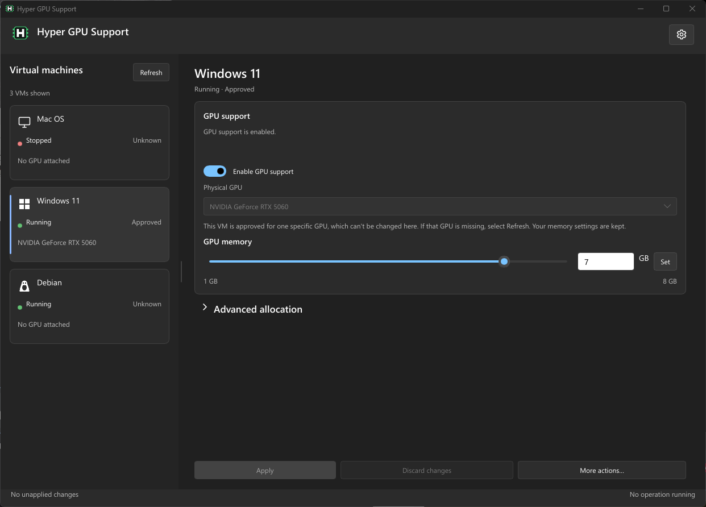
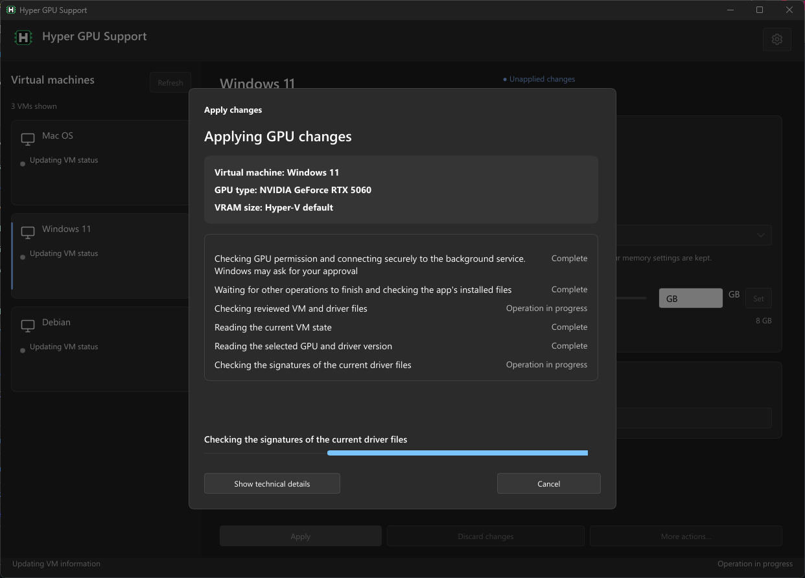
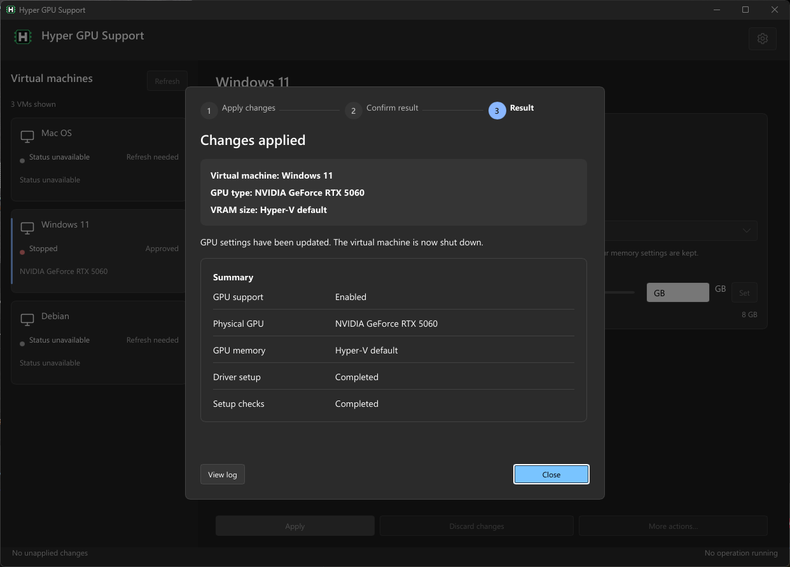
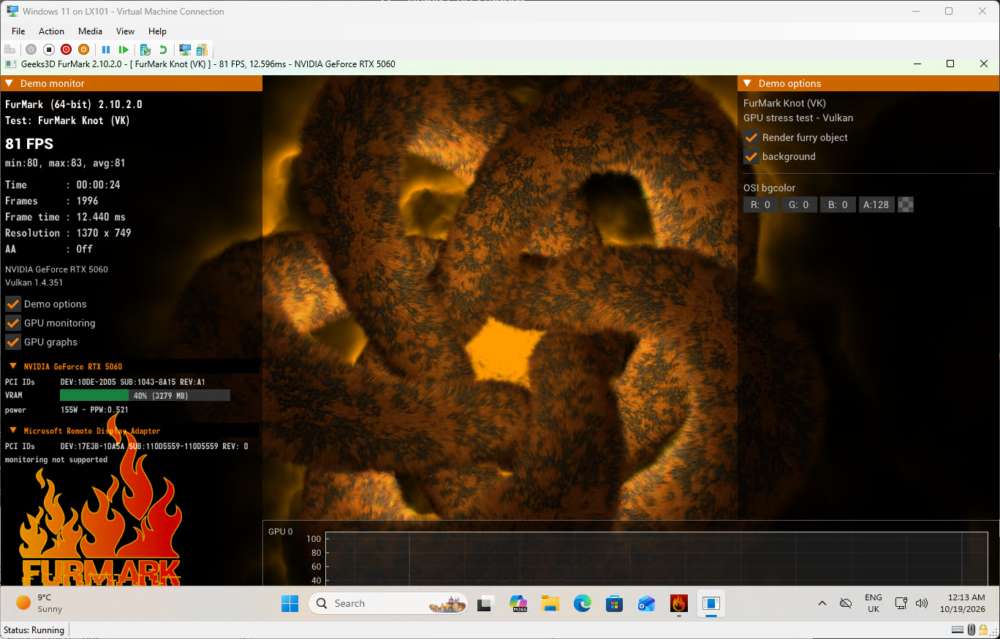

<div align="center">


# Hyper GPU Support

**Use your NVIDIA graphics card in a Hyper-V virtual machine.**

Hyper GPU Support makes GPU sharing easier to set up and manage on Windows 11. It handles the VM settings, installs the required NVIDIA driver files and checks that graphics acceleration works — all from a Windows app.

[Download](https://github.com/macg4dave/Hyper_GPU_Support/releases) · [Requirements](#requirements) · [Getting started](#getting-started) · [FAQ](#frequently-asked-questions) · [Report a problem](https://github.com/macg4dave/Hyper_GPU_Support/issues)



</div>

## What can it do?

- **Set up GPU support.** Choose a VM and graphics card, then let the app configure GPU sharing and install the NVIDIA driver files inside the VM.
- **Control graphics memory.** Turn GPU support on or off and change the amount of graphics memory assigned to each VM.
- **Check or repair a setup.** Check the installed driver files and graphics acceleration, or reinstall the drivers when needed.
- **Handle problems safely.** The app records interrupted changes and lets you review them before doing anything else. It doesn't force a VM to shut down or restart your PC.
- **Keep your details private.** Guest sign-in details are saved only if you choose **Remember**. The app collects no telemetry.

The interface has light and dark themes, keyboard controls and accessibility labels. The current interface language is British English.

## Requirements

You'll need:

- A 64-bit PC running **Windows 11 Pro, Enterprise or Education**, with Hyper-V enabled.
- An **NVIDIA graphics card** with its Windows driver installed on the host PC.
- An existing **Generation 2 VM running Windows 11**.

**Compatibility note:** Automatic guest driver setup currently supports NVIDIA GPUs only. The app doesn't verify the Windows version inside a VM; it displays an advisory warning instead. Don't assume other guest operating systems are supported.

## Getting started

### 1. Download and install

Get the latest Windows x64 installer from [GitHub Releases](https://github.com/macg4dave/Hyper_GPU_Support/releases). Download the **Setup `.exe`** rather than the binaries ZIP, and run the installer.

The downloads are currently **unsigned**, so Windows may warn that the publisher is unknown. You can compare the file's SHA-256 hash with the one published in the release notes.

**Important when updating:** Installing or updating resets the app's saved profiles, preferences, history, recovery records and remembered VM sign-in details. Protected state is archived first. Your virtual machines, virtual disks and files inside the VMs are not changed by the installer. Close the app and finish any running operation before installing or updating.

The ZIP contains the program files for advanced use. It does **not** install or register the protected runner. For package details, see [Release packaging](docs/releases.md).

### 2. Set up your VM

1. **Save any work in the VM.** The app may start and shut it down during setup. The VM must be running or turned off, not saved or paused.
2. Open **Hyper GPU Support**, then select your VM and graphics card on the dashboard.
3. Turn on **GPU support**, choose how much graphics memory to assign and select **Start GPU setup**.
4. Approve any Windows administrator prompts. When asked, enter the Windows sign-in details for the VM. Selecting **Remember** is optional.
5. Follow the setup progress until you see the final result. The app checks the driver files and tests hardware graphics, not just whether the files copied successfully.

When setup finishes successfully, the VM is left **turned off**. Start it again in Hyper-V Manager whenever you're ready.

### 3. Change settings later

Select a VM, change GPU support or graphics memory, and choose **Apply**. The app checks the VM before making changes and handles any normal shutdowns it needs. It leaves the VM turned off after the change.

Most changes don't need the full driver setup or graphics test again. Changes begin without an extra review screen; Windows permission and VM sign-in prompts still appear when needed.

## Screenshots

<details>
<summary><b>Show more screenshots</b></summary>

**Before GPU setup**


**Setting up GPU support**



**Setup complete**



**Changing graphics memory**


**GPU acceleration inside the VM**



</details>

## Frequently asked questions

<details>
<summary><b>Will it change anything else in my VM?</b></summary>

It changes the Hyper-V settings needed for GPU sharing. These can include GPU attachment and memory allocation, MMIO settings, guest cache settings and automatic checkpoints. Driver setup also copies files into the VM.

It doesn't change the VM's disk configuration, system RAM, CPU count or network settings.

</details>

<details>
<summary><b>What if setup fails or gets interrupted?</b></summary>

The app keeps a record of what happened rather than automatically trying the same change again. Open **More actions → Review recovery** to see what it can check or recover.

An unresolved problem normally prevents further changes to that VM. If the problem affects shared settings, or the app can't determine which VM it affects, other changes may also be blocked until it's reviewed.

</details>

<details>
<summary><b>Can I remove GPU support?</b></summary>

Yes. Choose **More actions → Remove GPU support**. This disconnects the GPU partition and restores the compatibility settings that the app still controls. The VM is left turned off.

It doesn't remove driver files from inside the VM or delete the app's saved permission and history. **Delete profile** removes the app's records for that VM, but doesn't disconnect the GPU or change the VM itself.

</details>

<details>
<summary><b>Can multiple VMs use the same graphics card?</b></summary>

Yes, but you must manage the allocations yourself. The app doesn't automatically balance GPU memory or warn if the total amount requested by your VMs exceeds the card's capacity. The memory allocation settings don't guarantee that one VM's usage is isolated from another's.

</details>

<details>
<summary><b>Does it save the password for my VM?</b></summary>

Only if you select **Remember** when entering the VM's sign-in details. Saved details are kept in Windows Credential Manager for your Windows account. Otherwise, they're used only for the steps you approve.

</details>

<details>
<summary><b>Will the VM be running when the operation finishes?</b></summary>

First-time setup, ordinary changes, driver reinstallations and GPU removal leave the VM turned off. A standalone verification returns a previously stopped VM to the off state; an already running VM stays running after successful verification.

</details>

<details>
<summary><b>Are other languages available?</b></summary>

Not yet. British English (`en-GB`) is the only language included. The language setting can follow Windows or select an available compiled language, but both currently use British English. See [UI text and languages](resources/i18n/README.md).

</details>

## Help and feedback

Found a bug, or have a suggestion? [Open a GitHub issue](https://github.com/macg4dave/Hyper_GPU_Support/issues). Reports from hardware and VM configurations that haven't been tested are particularly useful.

The app collects no telemetry. Its data stays on your computer. See the [Privacy policy](docs/privacy.md).

---

## Technical information

Details for advanced users, troubleshooting and contributors. You don't need these sections to use the app.

<details>
<summary><b>What each action does</b></summary>

| Action | Behaviour |
| --- | --- |
| **Start GPU setup** | Saves and confirms permission for the chosen VM and GPU, attaches a GPU partition, installs and checks the driver files inside the VM, tests Direct3D 11 and leaves the VM off. It then saves the requested settings. |
| **Apply** | Checks current VM and GPU settings, then applies the requested GPU on/off state or allocation. Normal changes leave the VM off. Driver-related work can also run guest setup and graphics checks. |
| **Verify GPU setup** | Checks driver files, the setup record, device status and hardware graphics without reinstalling anything. It restores a previously off VM to off; a VM that was already running stays running after successful verification. |
| **Repair / Reinstall** | Reinstalls the signed driver files even if previous checks passed, tests graphics and leaves the VM off. |
| **Remove GPU support** | Detaches the GPU partition, restores the compatibility settings the app still owns and leaves the VM off. It keeps the guest driver files, permission and history. No guest sign-in is needed. |
| **Remove partial GPU setup** | If offered during recovery, removes an interrupted GPU attachment and restores the original compatibility settings recorded for it. It preserves guest files and failure evidence. |
| **Delete profile** | Deletes the app's saved settings, permission, history and recovery records for that VM. It doesn't change the VM, its GPU attachment, power state, disks or guest files. |
| **Review recovery** | Reviews an interrupted or uncertain operation against the recorded and current state, and offers available recovery actions. Unresolved uncertainty keeps the hold in place. |

These actions start after fresh checks, without a separate review or confirmation screen. Windows permission and sign-in prompts are handled separately. Most maintenance actions are under **More actions**, and their availability depends on the selected VM and any recovery hold.

**Advanced allocation** allows exact minimum, optimal and maximum VRAM values in bytes. The app preserves existing values, including values below 1 GB, and keeps saved compute, encode and decode settings.

Hyper-V VRAM allocations don't guarantee isolation between VMs. The app doesn't balance them or warn if you allocate more than the card's capacity. It also doesn't check the Windows version inside the guest. Instead it shows a non-blocking warning before GPU installation, driver refresh or repair.

</details>

<details>
<summary><b>Safety and recovery</b></summary>

- The app records protected changes before they begin. An interrupted operation retains a recovery record and may prevent further changes until reviewed.
- Recovery checks the recorded outcome without repeating an **Apply** operation. It accesses the VM only when needed.
- The app never automatically repeats an uncertain change, forces a VM off or restarts the host PC.
- Opening the app checks for unfinished operations but doesn't repair or repeat them.
- **Delete profile** removes recovery records as well as other app data. It doesn't undo changes made to the VM.
- If the GPU change succeeds but saving its settings fails, you can retry saving without repeating the change.
- Failure details retain the original error alongside the latest VM power and recovery state.
- The app checks live GPU settings against its saved record and reports differences before repair or removal.

</details>

<details>
<summary><b>Security and permissions</b></summary>

- The GUI normally runs without administrator rights. Protected operations use a separate installed runner started by a scheduled task. First-time protected setup uses its own UAC-approved process.
- Installed executables are verified against pinned SHA-256 hashes. Protected policy, path and permission checks restrict execution; local pipe connections authenticate their peers.
- Driver files are checked using embedded signatures or catalogue membership. Guest helpers and diagnostic checks use approved hashes. Invalid replies from the VM are treated as communication failures.
- VM credentials are used only for approved steps. They're saved to Windows Credential Manager for the current user only when **Remember** is selected.

</details>

<details>
<summary><b>Command-line tools</b></summary>

Running `hyper-gpu-support.exe` without arguments opens the interface. The commands below are mainly for existing configuration records and recovery; use the GUI for routine operations. Run `--help` for command syntax.

| Command | Purpose |
| --- | --- |
| `install --config FILE` | Register the protected runner using existing configuration. For normal installation and updates, use the installer instead. |
| `import --config FILE` | Import settings into missing per-VM files without approving or applying changes. |
| `save-only --operation ID` | Retry saving an operation that's already been verified. |
| `reconcile --operation ID [--approve-shutdown]` | Review a recorded operation without repeating it. |
| `import-reconcile --operation ID` | Resume an interrupted import. |
| `native-review --job REFERENCE` | Review a recorded Hyper-V job. |
| `native-reconcile --review TOKEN` | Approve clearing a previously reviewed Hyper-V job record. |

Configuration files use TOML schema 2 or 3. See [product.example.toml](config/product.example.toml).

</details>

<details>
<summary><b>Build from source</b></summary>

You need Git, [Rust](https://rustup.rs), Visual Studio C++ build tools and a Windows SDK for the `x86_64-pc-windows-msvc` target. The Rust version is selected by [rust-toolchain.toml](rust-toolchain.toml). Creating an installer also requires [Inno Setup 6.7.3](https://github.com/jrsoftware/issrc/releases/tag/is-6_7_3).

```powershell
git clone https://github.com/macg4dave/Hyper_GPU_Support.git
cd Hyper_GPU_Support
cargo build --locked --release --bins
powershell -NoProfile -File scripts/build-installer.ps1
```

The first build command compiles the executables; it doesn't install the app. The packaging script checks the build and produces:

- `dist/HyperGpuSupport-<version>-windows-x64-unsigned-setup.exe`
- `dist/HyperGpuSupport-<version>-windows-x64-unsigned-binaries.zip`
- `dist/SHA256SUMS.txt`

Both packages contain five executables and licence notices. The ZIP also includes the executable hash manifest and [install.txt](packaging/install.txt). If Inno Setup isn't found automatically, pass `-IsccPath 'C:\path\to\ISCC.exe'` to the packaging script. No signing account or credentials are needed.

To build the local installer and launch its setup wizard:

```powershell
cargo run -p app-install
```

The launcher asks you to type `yes` before it proceeds. Add `-- --yes` to skip that typed confirmation. `--skip-build` can reuse existing release binaries while still running packaging checks. The debug source launcher should be used because a running release helper cannot rebuild itself. The installer asks for administrator permission and shows the state-reset warning.

The script doesn't install or launch the app by itself. To run the installed app directly:

```powershell
& "$env:ProgramFiles\HyperGpuSupport\hyper-gpu-support.exe"
```

See [Release packaging](docs/releases.md) for distribution details. Official release preparation uses a GitHub workflow to check the tag, versions and package contents. Publishing a release is still a manual step.

</details>

<details>
<summary><b>Installation, updates and removal</b></summary>

Use the Inno Setup installer for both fresh installs and updates. Close the app and let operations finish first. Setup checks that the app and helpers are stopped, protected tasks are idle and operation locks are available; it doesn't close or restart the app for you.

After Windows administrator approval, Setup archives protected state from `%ProgramData%\HyperGpuSupportProduct` and the older `%ProgramData%\HyperGpuSupport` folder into an administrator/SYSTEM-only folder under `%ProgramData%\HyperGpuSupport-archives\install-<time>-<process>`. It verifies the archive by hash, stops cleanup if archiving fails, and retains any partial archive. These archives survive updates and uninstall. The former `--no-archive` option isn't supported.

A Rust maintenance helper resets protected registration, scheduled tasks and runtime state. Inno installs the four main executables and maintenance helper into `%ProgramFiles%\HyperGpuSupport`, along with the Start menu shortcut and Windows Installed Apps entry. Before clearing local preferences and remembered guest sign-in details for the person who ran Setup, it checks the five executable hashes against the package manifest. This also applies if the administrator approval uses a different account. Launching Setup manually as administrator is refused; start it normally.

**Installing or updating clears app-owned state**, including profiles, history, recovery records, preferences, remembered VM sign-in details and protected registration. It doesn't alter your VMs, disks, guest files or a configured `data_root`. First-time setup in the app registers the protected runner again. Opening the app normally doesn't trigger this reset.

To uninstall, use Windows **Installed apps**. Uninstall won't proceed while protected work is active. It archives protected records, removes registration and app state, and removes the installed files. It leaves other users' preferences and saved VM credentials untouched and doesn't scan their profiles or credential stores.

For more information, see [Release packaging](docs/releases.md), [release preparation](docs/releases.md#preparing-and-publishing-an-update) and [third-party notices](licenses/THIRD_PARTY_NOTICES.md).

</details>

<details>
<summary><b>Contributing</b></summary>

The app is written in **Rust**, with its interface built using [Slint](https://slint.dev). UI text is stored in a compiled catalogue, using British English as the reference; backend and worker diagnostics remain in English.

- [AGENTS.md](AGENTS.md) — guidance for Codex and Claude Code.
- [UI text and languages](resources/i18n/README.md) — language catalogue and format.

The app icon is in [icons/](icons/), and screenshots are in [docs/images/](docs/images/). Don't commit passwords, VM disks, driver payloads or machine-specific diagnostic evidence.

</details>

---

<div align="center">

Released under the [MIT licence](LICENSE). Built with [Slint](https://slint.dev).

</div>
