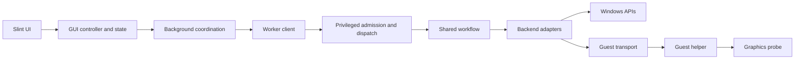

# Operation contracts and implementation complexity

Reviewed: 18 October 2026.

Source baseline: `843997179407e727a7f2cb5edc587d9df74a8e27`, with an existing working-tree edit to `.github/prompts/rust.prompt.md`. That edit was preserved. The source counts below were reconfirmed when this document was written.

## Purpose and status

Describe the major operations from first principles, then compare those responsibilities with the current implementation's layers and function routes. This is a point-in-time source assessment requested by the user, not a new set of product requirements, an implementation plan, or runtime acceptance evidence.

The codebase has accumulated substantial coordination around a relatively small set of product operations. Most GPU changes already share one execution engine. The main maintenance burden is following an operation through preparation, GUI state, worker admission, progress, recovery, publication, and completion.

The [agreed workflow](../README.md#agreed-workflow), [architecture](ARCHITECTURE.md), [security](SECURITY.md), and [configuration](CONFIGURATION.md) remain the owning references. Following this assessment, the user set a 10,000-line code goal excluding Rust tests, later clarified to cover `src/` only and requested a single coherent core. Unused tests should be removed and useful tests should follow the program's design. The [roadmap](roadmap.md) now owns the proposed simplification design and [backlog](backlog.md) owns its tasks. The assessment below describes the source baseline, not an implemented replacement.

## Operations from first principles

| Operation | Essential behaviour |
| --- | --- |
| Open / Refresh / Poll | Read existing VMs, GPUs, saved settings, permissions, and unfinished work. Present those facts separately. Preserve unsaved edits and reject obsolete background results. |
| Install application / enrol a pair | Install the trusted application components if needed, grant this operator permission for the exact VM/GPU pair, and confirm that permission was saved. GPU configuration follows as a separate operation. |
| First GPU setup | Validate the target and driver files; prepare the guest while the GPU is detached; stop the guest; configure and attach the GPU; apply allocations; boot and check actual graphics operation; finish with the VM off; save only the confirmed result. Preparation can be reused only when its evidence remains eligible. |
| Change VRAM / ordinary re-enable | Confirm existing preparation remains eligible. Stop the VM where required, change only the necessary host settings or attachment, independently check the result, and save it. Successful changes leave the VM off. |
| Disable GPU support | Stop the VM gracefully, detach the managed GPU, restore only compatibility settings the application still owns, confirm the result, and save disabled intent. Retain guest driver files. |
| Repair / Reinstall | Explicitly repeat complete driver preparation and graphics verification for the selected pair. Use the setup machinery and finish with the VM off. Matching files may be retained after independent checks. |
| Verify | Check current guest files, device health, and hardware rendering. Temporarily boot an off VM and restore its permitted power state. Record the check without changing saved GPU intent. An external stop does not authorize restarting the guest. |
| Recover an interrupted operation | Read the durable record and current facts. Establish what happened before choosing an allowed completion or restoration. Do not replay Apply. Retain uncertainty when proof is insufficient. |
| Remove partial GPU setup | Use the interrupted operation's recorded scope to remove its partial host attachment and restore attributable host settings. Preserve guest files and failure evidence. |
| Retry saving | Confirm the previously verified result is still valid, then publish its exact settings. Do not repeat GPU changes or guest installation. |
| Delete profile | Remove the selected VM's application settings, permission, history, and associated recovery records, with resumable deletion. Leave the actual VM, GPU attachment, and guest files alone. |
| Import configuration | Validate the complete input and destination set, publish into permitted absent destinations, and track partial publication. Importing settings grants no GPU execution authority. |
| Manage credentials | Use local Windows prompts and the user's vault for the selected VM. Cancellation preserves existing credentials. No guest connection is needed. |

Cancellation is a shared rule: abandoning read-only preparation must prevent its later execution, while retaining admission until the backend actually releases it. Effects already approved require truthful completion or recovery handling.

Appearance settings and inspection of already-loaded diagnostics are presentation operations. They do not need a new protected effect workflow. Explicit refresh or verification initiated from those views remains a separate operation.

## Current responsibility layers

Most host effects pass through eight responsibility groups:



These groups describe responsibilities, not distinct security boundaries or stack frames. Worker operation handlers are included in privileged admission/dispatch; progress wrappers and the native adapter are grouped under backend adapters. Guest preparation and verification add the transport, guest helper, and graphics-probe branches. Protected inventory reads use their own runner/observation route rather than the effect workflow.

Relevant sources: [GUI actions](../src/gui/live/actions.rs), [background coordination](../src/gui/live/background.rs), [worker client](../src/worker/client.rs), [worker server](../src/worker/server.rs), [locked dispatch](../src/worker/dispatch.rs), [shared workflow](../src/workflow.rs), [observable backend](../src/worker/progress.rs), [native backend](../src/worker/runner/backend.rs), and [guest transport and helper](../src/guest.rs).

## Main-route function comparison

### Counting method

The following counts identify named functions on selected main orchestration routes in the Windows implementation. A function is identified by its file and name; equal names in different modules count separately. Counts include named handoffs across processes and preparation/execution phases, not just a continuously nested call stack.

The counts are lower bounds. They omit the Slint callback itself, most validation helpers, process-launch and pipe primitives, serialization, progress callbacks, individual backend effects, and most completion/readback/publication branches. File counts cover only those selected functions, not every file involved in the operation. Shared functions are counted in each applicable operation row; rows must not be summed into a unique repository total.

Logical product steps and function counts measure different things. A large count helps locate navigation and coordination cost; it does not by itself prove that a function or safeguard is unnecessary.

| Operation | Main-route functions | Files containing those functions | Current implementation |
| --- | --- | --- | --- |
| Installed Refresh / startup read | 15+ | 7 | GUI refresh, background handling, protected runner, observation bundle, and Hyper-V inventory. Startup adds lifecycle work outside this count. |
| Automatic Poll | 14+ | 8 | Similar protected read route, with polling tickets and stale-result suppression. |
| Initial application installation | 9+ | 4 | Separate bootstrap route, followed by refresh and GPU Apply outside this count. |
| Enrol an additional pair | 12+ | 8 | Worker execution, pairing handler, and protected permission publication. Preparation and subsequent refresh are additional. |
| First GPU setup | 18+ | 10 | Common Apply route, plus guest preparation and verification outside this count. |
| VRAM change / ordinary re-enable | 18+ | 10 | Same Apply route; its decision selects fewer effects. |
| Disable GPU support | 18+ | 10 | Same Apply route; payload preparation and guest checks are skipped. |
| Repair / Reinstall | 18+ | 10 | Same Apply route with explicit reinstall intent. |
| Verify | 15+ | 8 | Prepared worker exchange and separate verification workflow; guest checks are additional. |
| Operation reconciliation | 12+ | 7 | Recovery continuation, worker recovery handler, and reconciliation workflow. Record-only outcomes can finish before that full route. |
| Partial setup removal | 13+ | 7 | Bound removal review, worker recovery, and host restoration workflow. |
| Save-only retry | 10+ | 6 | Worker dispatch and recovery handler. Host/payload validation and protected publication are additional. |
| Profile deletion, execution phase | 12+ | 8 | Worker/pairing/removal publication. Separate protected preparation and subsequent refresh are additional. |
| Configuration import, CLI | 9+ | 5 | CLI, worker dispatch, import handler, and per-document publication orchestrator. |
| Credential management | 5+ | 4 | GUI/background/source forwarding and credential manager. Native prompt/vault helpers are additional. This describes the implemented handler, not proof of a currently visible settings control. |

### Apply example: 18 named orchestration functions

```text
gui/live/review.rs:       review -> review_operation
gui/live/apply.rs:        apply_live
gui/live/background.rs:   background_operation -> background_for_vm
worker/preparation.rs:    apply_prepared
worker/client.rs:         submit_with_preparation
worker/server.rs:         serve
worker/dispatch.rs:       execute -> execute_inner
worker/preparation.rs:    execute
workflow/apply.rs:        prepare_apply
workflow/planning.rs:     decision_for_operation -> decision_inputs -> plan_from_decision
worker/operations.rs:     apply
workflow/apply.rs:        apply_admitted -> execute_decision
```

This is an ordered list of main-route milestones, including returns between preparation and execution. It ends at the core executor. First setup, ordinary changes, Disable, and Repair / Reinstall all converge here; they are not five separately implemented engines.

One allocation write inside that executor then passes through:

```text
ApplyFacts::allocation
  -> ObservedBackend::allocation
  -> NativeBackend::allocation
  -> windows_hyperv::allocation
  -> WMI implementation
```

These functions maintain expected facts, report progress and mark effects started, adapt the backend, and perform the native change. See [ApplyFacts](../src/workflow/apply/facts.rs), [observable backend](../src/worker/progress.rs), [native backend](../src/worker/runner/backend.rs), and [Hyper-V effects](../src/windows_hyperv.rs).

### Other route definitions

These abbreviated traces make the table's selected-function counts inspectable. Prefixes distinguish equal function names in different modules. Background shorthand expands to `background_operation -> background_for_vm` for GPU operations, or `background -> background_for_vm` for ordinary foreground work. Worker dispatch expands to `worker/server::serve -> worker/dispatch::execute -> worker/dispatch::execute_inner`. Ordinary worker submission expands to `worker/client::submit -> submit_with_preparation`.

| Route | Selected functions |
| --- | --- |
| Refresh (15) | `refresh -> refresh_with_result -> background_refresh -> background -> background_for_vm -> Source::observe -> runner/ipc::submit -> submit_read -> serve -> execute -> execute_inner -> execute_operation -> runner/observation::read -> ReadSession::discover -> inventory::discover` |
| Poll (14) | The Refresh route replaces `background -> background_for_vm` with `Ticket::read`. |
| Bootstrap (9) | `review_enrollment -> background -> background_for_vm -> enroll_live -> setup::install -> setup::submit -> setup::serve -> installation::bootstrap_install -> install_inner` |
| Enrollment execution (12) | `enroll_live`, ordinary foreground background pair, `worker/client::enroll_pair`, ordinary worker submission pair, worker dispatch triple, `worker/pairing::enroll -> runner/pairing::enroll_pair -> enrollment::publish_pair`. |
| Verify (15) | `review_verification`, GPU background pair, `verify_prepared -> submit_with_preparation`, worker dispatch triple, `preparation::execute -> prepare_verification -> plan_verification -> verification_plan -> operations::verify -> verify_admitted -> verify_current_payload`. |
| Reconciliation (12) | `continue_recovery -> reconcile_live`, GPU background pair, `worker/client::reconcile`, ordinary worker submission pair, worker dispatch triple, `worker/recovery::reconcile -> workflow::reconcile_with_graphics`. |
| Partial removal (13) | `review_reset -> partial_removal_candidate -> reset_live`, GPU background pair, `worker/client::reset_partial`, ordinary worker submission pair, worker dispatch triple, `worker/recovery::reset_partial -> workflow::reset_partial`. |
| Save-only (10) | `save_only_live`, GPU background pair, `worker/client::save_only`, ordinary worker submission pair, worker dispatch triple, `worker/recovery::save_only`. |
| Profile deletion execution (12) | `forget_live`, ordinary foreground background pair, `worker/client::forget_pair`, ordinary worker submission pair, worker dispatch triple, `worker/pairing::forget -> runner/profile_removal::forget_pair -> enrollment::publish_removal`. |
| CLI import (9) | `main::execute -> worker/client::import`, ordinary worker submission pair, worker dispatch triple, `configuration_import::import -> publish_import_record`. |
| Credentials (5) | `review_credentials -> background_for_vm -> Source::credentials -> credential_dialog -> credentials::manage_named`. |

The operation-specific sources are [Verify](../src/gui/live/verification.rs), [enrollment](../src/gui/live/enrollment.rs), [recovery](../src/gui/live/recovery.rs), [partial removal](../src/gui/live/partial_removal.rs), [profile deletion](../src/gui/live/profile_removal.rs), [bootstrap](../src/setup.rs), [configuration import](../src/worker/configuration_import.rs), and [credential management](../src/gui/live/credentials.rs).

## Size snapshot

Counts cover files under `src` and include tests, comments, and blank lines. Rust function totals are lexical declaration counts, including methods and trait declarations; they are not compiler-derived call-graph measurements. The Windows and non-Windows alternatives remain in these source totals.

| Source area | Rust lines, including tests |
| --- | --- |
| GUI: `src/gui/` | 13,425 |
| Worker and runner: `src/worker/` | 7,509 |
| Shared workflow: `src/workflow.rs` and `src/workflow/` | 5,821 |
| Windows adapters: `src/windows_*.rs` and their child modules | 4,840 |
| Other Rust source | 12,755 |
| All Rust source | 44,350 across 140 files |

The lexical count found approximately 1,527 named Rust function declarations, including 470 `#[test]` declarations. Slint contributes another 1,570 lines across 12 files. The Rust GUI accounts for about 30% of Rust source lines. These figures must not be presented as production logic alone or as evidence of runtime slowness.

## Findings and simplification priorities

### 1. Planning and execution describe the action sequence separately

[plan_from_decision](../src/workflow/planning.rs) constructs shutdown, preparation, attachment, allocation, verification, and restoration actions. [execute_decision](../src/workflow/apply.rs) separately implements that ordering. Both use the shared decision calculation, which is useful reuse, but a sequencing change still requires keeping two descriptions aligned.

Simplification candidate: give the required effect sequence one authoritative representation and derive the displayed plan from it, while preserving stage-specific execution guards. This requires design work before implementation; the finding does not justify introducing a generic workflow framework.

### 2. Apply and Verify repeat worker lifecycle mechanics

[Worker operations](../src/worker/operations.rs) constructs similar recovery receipts, records the first effect, executes admitted work, confirms results, and persists verification for both operations. Shared confirmation/publication helpers already remove some repetition. Operation-specific receipt construction and lifecycle handling remain substantial.

Simplification candidate: consolidate identical lifecycle mechanics while keeping Apply publication and Verify's non-publication semantics explicit.

### 3. Completion ownership is distributed

The [background wrapper](../src/gui/live/background.rs) gathers protected readback; action callbacks interpret terminal outcomes; [state completion](../src/gui/live_state/recovery.rs) merges saved intent and recovery; [refresh presentation](../src/gui/live/refresh.rs) republishes models and preserves result notices. Understanding what establishes successful completion requires following all of them.

This is the first simplification priority: give shared completion mechanics a clear owner and keep each operation's final result interpretation readable in one place. Preserve the distinction between a terminal operation outcome, current observations, and confirmed saved intent.

### 4. Multiple admission routes remain active

[Prepared execution](../src/worker/preparation.rs) retains the authenticated backend and private admission token. Approved-plan execution independently admits an earlier plan. [Worker operation handlers](../src/worker/operations.rs) accommodate both through an optional retained backend/token. GUI and CLI callers do not all use the same route.

Simplification candidate: audit actual callers and required compatibility contracts before consolidating entry points. A frontend simplification alone does not retire the alternative path. No route was established to be unused by this review.

### 5. Small operations inherit substantial coordination

Save-only and profile deletion traverse roughly 10-12 selected execution functions before most lower-level work is counted. Save-only also performs current host/payload checks; profile deletion has its own protected preparation and refresh. They are intentionally narrower than GPU Apply, but that narrow scope is harder to see through shared infrastructure.

Simplification candidate: make these operations readable from one orchestrator and require forwarding helpers to justify their maintenance cost. Reuse existing mechanisms rather than creating a second implementation of admission, storage, or recovery.

## Boundaries that remain justified

The protected process boundary, exact target binding, serialized effects, durable interruption records, guest transport, and independent readback address different failure conditions. Checks before a mutation, after it, and before saving can establish different facts. Their repetition alone is not evidence that they can be deleted.

Saved intent, observed VM state, historical preparation evidence, worker recovery receipts, and native provider recovery represent different facts and failure domains. Simplification should make their ownership and transitions easier to follow without merging away those distinctions.

The follow-up [core design](roadmap.md#the-core) consolidates completion ownership, sequencing and prepared admission. In particular, the subsequent caller trace found the live CLI ordinary path in `main.rs` using `OrdinaryPlan -> worker::apply`, while setup and GUI execution use retained prepared admission. The first OPT-009 slice has since migrated that caller and removed the detour, introduced one Configure step sequence, and shared completion merging. See the [source checkpoint](ENGINEERING.md#core-simplification-checkpoint) for passing automated evidence and limits. The route/size tables above remain the original baseline; they do not describe the simplified candidate.

The original 44,350-line Rust count covers only Rust under `src`. The follow-up [gross inventory](ENGINEERING.md#size-accounting) is **50,595 handwritten code lines**, including Slint, guest PowerShell, tests, tools and build code. The goal now covers `src/` only, excluding Rust tests and test-only helpers. Its corrected baseline is 29,141 counted lines, the first core slice is 28,938 and the GUI batch including captured-request cleanup is 28,541. The subsequent [worker lifecycle checkpoint](ENGINEERING.md#worker-lifecycle-checkpoint) is 28,346 counted lines. Repository tools are outside the goal; program logic must not be moved out of `src/` to evade it. The [engineering checkpoints](ENGINEERING.md#gui-simplification-checkpoint) retain earlier wider inventories as history. Catalogue/contract TOML is separate data and remains a maintenance concern. Tests have no line budget and do not require retaining obsolete production design.

## Validation and limits

- Completed: read-only source tracing, working-tree inspection, and static source counts. Counts were reconfirmed while writing this document.
- Passed: `python -B scripts/testing/check-docs.py` (36 Markdown files, one task card, zero errors), `git diff --check`, and a whitespace/final-newline check of this new document. These are documentation checks, separate from product validation.
- Not run for this review: builds, product tests, GUI launches, native prompts, installed IPC probes, installation, guest access, or VM/GPU operations.
- Not established: complete compiler-resolved call graphs, runtime call counts, measured performance, unused-code proof, or a safe deletion list.
- Existing unrelated edits were preserved. This document records review findings; it does not close an acceptance gate.
